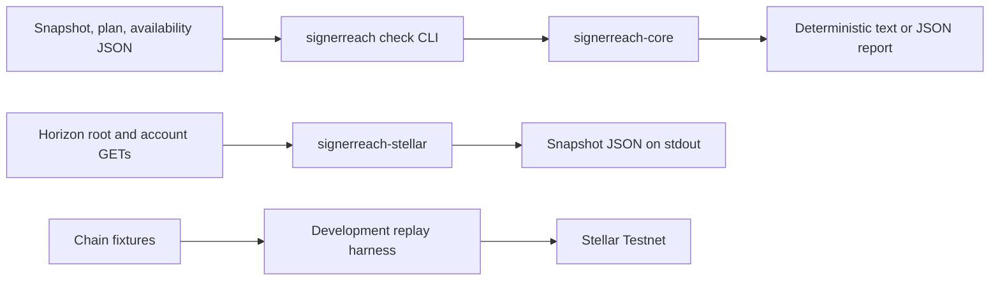

# Architecture and scope

Checked against the repository on 2026-10-31. This describes the implemented
Rust CLI and the separate development replay tool.

## Smallest complete workflow

Build the binary, obtain or write a snapshot, supply a plan and signer
availability declaration, then run `signerreach check`. Read the verdict,
transaction trace, diagnostics and coverage before deciding whether to submit a
real transaction elsewhere. `check` has no network path. `fetch` is an optional
read-only way to obtain a snapshot. Neither command signs or submits.

## Crates and I/O

| Component | Responsibility | I/O boundary |
|---|---|---|
| `signerreach-core` | Strict input parsing, classic-account model, authorization, state transition, scenarios, diagnostics and reports | Pure evaluation, no file, clock or network access |
| `signerreach-stellar` | Validate Horizon URL, GET root and account data, map a response to a snapshot | Network reads only; no signing or submission |
| `signerreach-cli` | Parse arguments, read three local files, call core, print reports; `fetch` calls the Stellar adapter | File and terminal I/O; only `fetch` has a network path |
| `tools/replay` | Build throwaway Testnet accounts and replay chain fixtures | Separate Node development tool; live mode signs and submits on Testnet |

The binary has no database, server, contract, cross-repository dependency, or
hosted state. Its version is currently `0.0.0` and it is unreleased.

## Inputs and trust boundaries

The supported document identifiers are `signerreach.snapshot/1`,
`signerreach.plan/1` and `signerreach.availability/1`. Their fields and limits
are defined in [SPEC.md](SPEC.md#5-inputs). The CLI caps each file at
1 MiB. The core rejects malformed JSON, duplicate keys, unknown fields,
invalid G addresses, out-of-range weights and thresholds, unsupported signer
types, and unsupported protocol versions. Unknown field names and malformed
values are not echoed in errors. Reports deliberately show validated public
addresses, keys, IDs, scenario names and home domains. Users must keep secrets
out of those public fields.

The snapshot is an assertion about one classic account. A hand-written
snapshot is trusted only to the degree its author is trusted. `fetch` checks
the Horizon network passphrase before reading an account, then reads the root
again and refuses a network or protocol change during the request. It checks
the response account IDs against the requested G address, rejects duplicate
JSON keys and ledger contradictions, and records the `Latest-Ledger` response
header and HTTP `Date`. The two root reads do not make the account read
atomic. A proxy or a lagging Horizon server can still supply stale data, and
the ledger header is the server's latest known ledger, not proof that the
account state changed at that ledger. Re-fetch and review the live account
before acting.

## Authorization and state transition

For every transaction, core checks the source account's LOW threshold for the
envelope and the required threshold for each `SetOptions` operation. Changing
a signer, master weight or threshold needs HIGH; a supported non-administrative
`SetOptions` needs MEDIUM. Signer weights and thresholds come from the state
before the transaction. All operations in that transaction are checked against
that same state. If authorized, operations are applied in order to produce the
next transaction's pre-state. A rejected or failed transaction leaves the
state unchanged. An undecidable transaction stops later evaluation because the
next pre-state is unknown.

`signed_by` declares which signatures the transaction is assumed to contain.
The tool does not create or cryptographically verify them. It rejects
duplicates and signatures with no signer in the pre-state. If an unnecessary
signature could be treated differently depending on signature order, the
result is `INCONCLUSIVE`. It does not assume a key marked lost could not have
signed a transaction in advance. The user must establish that every declared
signature can actually be supplied.

The final state is checked under the baseline availability declaration and
each named scenario. `available`, `lost` and `unknown` are user assertions.
The optional loss-of-one requirement checks whether HIGH remains reachable
after any one available signer is removed. The worst plan or scenario finding
sets the overall verdict: `UNSAFE`, `INCONCLUSIVE` or `SAFE WITHIN SCOPE`.
Text and versioned JSON reports include diagnostics and coverage. Identical
validated inputs produce identical report bytes.

Recognized unsupported constructs fail closed. Account flag changes are
`INCONCLUSIVE` because existing flags are absent from the snapshot. Protocols
other than 29 are `INCONCLUSIVE`. The model does not determine reserve
sufficiency, account changes after the snapshot, actual key custody, or whether
the user can obtain every declared signature. A `SAFE WITHIN SCOPE` verdict
therefore cannot guarantee acceptance or future access. These boundaries are
listed in the report and [security review](security-review.md).

## Tests, fixtures and replay

Core unit tests own parsing, thresholds, authorization and verdict logic.
CLI integration tests own exit codes, report formats and offline behavior.
Stellar adapter tests use a local fake HTTP server. The
[fixture corpus](../fixtures/README.md) gives expected outcomes for chain
observations and synthetic edge cases. Observed chain outcomes are never
changed to satisfy the checker.

The replay harness is not linked into the shipped binary. Its dry run builds
and signs fixture transactions in memory without network requests. Live mode
uses temporary Testnet keys, Friendbot and Horizon, and refuses any protocol
other than 29 before funding or submission. It checks plans' own transactions;
the follow-up lockout attempts in the original 2026-10-13 evidence are not
replayed by this harness. See [issue #3](https://github.com/signerreach/signerreach/issues/3).

## Future work and explicit exclusions

The existing issues cover JSON Schema output, Markdown reports and a proposed
format for replaying follow-up attempts. None is required to operate the
current CLI. Protocol 30 rules need independent verification before the support
boundary changes. There is no requirement for a frontend, database, API,
contract, custody path or live replay in ordinary CI.
